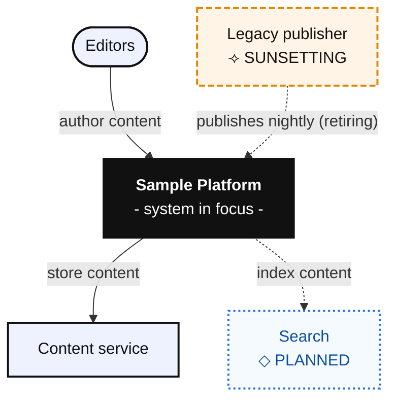

# Sample Platform - C4 **L1 · System Context**

**C4 level:** 1, System Context · **View:** Hybrid *as-is / to-be* · **Scope note:** Regional replica held off the canvas by driver: data-residency decision of 2026-09-01
**Importable diagram:** [`C4-L1-system-context.mmd`](../diagrams/C4-L1-system-context.mmd)
**Prepared by:** Jane Doe, Architect · baseline 2026-10-01 · **Version:** 0.1.0

---

## Executive Summary

A smoke-test sample for the package audit. Editors author content that the platform stores and will index.

## Diagram

## Walkthrough

- **Content service.** Present; stores authored content.

## References

- Sample: [Example decision record](https://example.com/adr/1)
